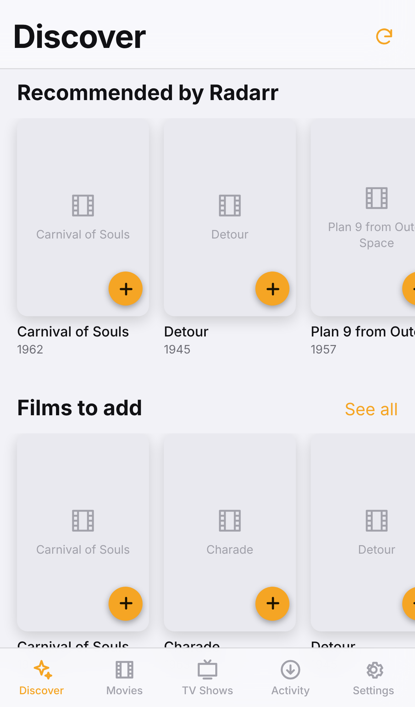
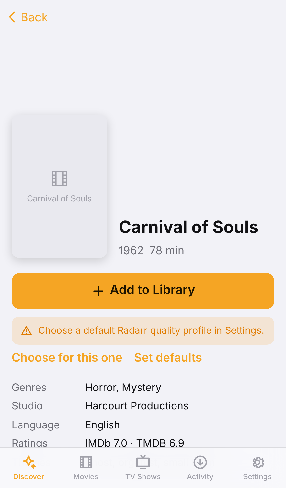
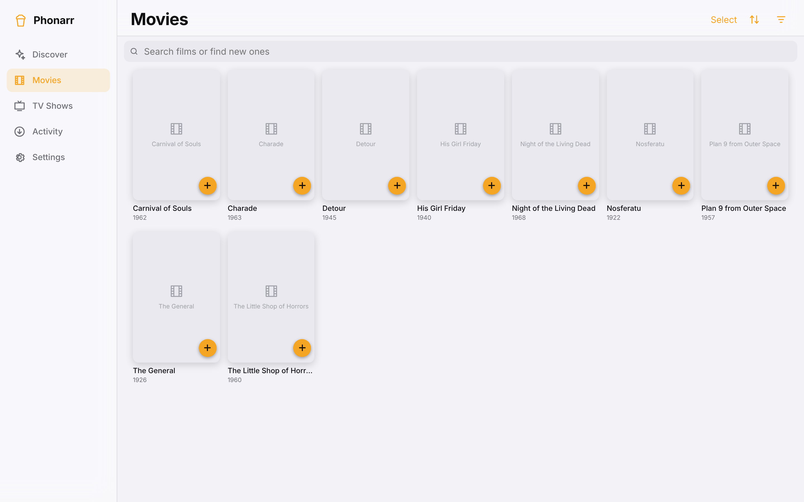

# Phonarr

Discover films and TV shows and add them to your existing Radarr and Sonarr in one tap. Inspired by Seerr. Product requirements: [seerr_iphone_app_prd.md](seerr_iphone_app_prd.md).

## Screenshots

The web app on an iPhone 13 (Discover and a title's details) and on a 1440 px desktop browser, running against the simulated Radarr/Sonarr from `./dev.sh` (so posters show placeholders).

<p>
  
  
</p>


## Backend and frontends

There is one **backend** and two **frontends**. The backend is the only thing that talks to Radarr and Sonarr, and the only thing that holds their API keys.

```
                    ┌──────────── your server (Docker, next to Radarr/Sonarr) ────────────┐
 Browser ──────────▶│  phonarr container                                               │
 (phone, laptop,    │    /           web app (static files from web/)                      │──X-Api-Key──▶ Radarr
  home screen app)  │    /v1/*       gateway API (backend/, FastAPI)        ◀── bearer token │──X-Api-Key──▶ Sonarr
                    │    /console/   API console (test every endpoint with curl)           │
 iPhone app ───────▶│    /v1/health  is it up? (Docker healthcheck, no token)              │
 (SwiftUI, ios/)    │    SQLite in data/: keys, defaults, requests, metadata cache         │
                    └──────────────────────────────────────────────────────────────────────┘
```

| Part | Folder | What it is | Where its code runs |
|---|---|---|---|
| **Backend (gateway)** | `backend/` | Python FastAPI service + SQLite. Polls Radarr/Sonarr, de-duplicates requests, serves `/v1` | In the Docker container on your server |
| **Web frontend** (main) | `web/` | A PWA: plain HTML, CSS and JavaScript modules, no build step | Served *by the gateway container* at `/`, runs in your browser. Add it to the iPhone home screen and it opens like an app |
| **iPhone app** (second frontend) | `ios/` | SwiftUI, iOS 17+, no dependencies | On your iPhone, built with Xcode on a Mac |

Both frontends do the same things (Discover, Movies, TV Shows, details, filters, More like this, multi-select, Customize Request, Activity, Settings, API compatibility, System status, debug report) through the same API. Neither ever sees a Radarr or Sonarr API key.

## Build and run: one script per target

| You want to | Run | Where |
|---|---|---|
| **Run it for the browser** (gateway + web app) | `./build-web.sh` | On the server next to Radarr/Sonarr |
| **Build the iPhone app** | `./build-ios.sh` | On a Mac with Xcode |
| Work on the code with fake Radarr/Sonarr | `./dev.sh` | Any machine with Python 3.12 |
| Run every test | `./test.sh` | Any machine with Python 3.12 and Node 18+ |

Helpers those four use live in `scripts/`; you never run them directly. Each root script is a short, straight list of steps with no options to learn.

### Browser (the main way to use it)

```bash
./build-web.sh          # first run creates backend/.env: set ARR_GATEWAY_TOKEN (openssl rand -base64 32), ARR_NETWORK, PUID/PGID and TZ, run again
```

Then open `http://<server>:8787/`, or the server's Tailscale address on your phone (`http://100.x.y.z:8787/`), and sign in with the token. To get an app icon on the iPhone: Safari → Share → **Add to Home Screen**.

**Already run your Arr stack from one big `docker-compose.yml`?** Don't use `build-web.sh`. Paste the service from [`backend/compose-entry.yml`](backend/compose-entry.yml) into your file. It pulls the prebuilt image `ghcr.io/danielbaker1994/phonarr`, which GitHub Actions builds on every push ([`.github/workflows/docker-image.yml`](.github/workflows/docker-image.yml)). It uses the same `PUID`, `PGID` and `TZ` as linuxserver.io's Radarr and Sonarr images and takes care of the data folder's permissions itself. Setup steps: [docs/DEPLOYMENT.md §2](docs/DEPLOYMENT.md); what's supported in Docker and what isn't yet: [§2.7](docs/DEPLOYMENT.md).

### iPhone app (optional)

```bash
brew install xcodegen
./build-ios.sh          # generates ios/Phonarr.xcodeproj and opens Xcode: set your Team, pick your phone, Run
```

On first launch enter the gateway address (`http://100.x.y.z:8787`) and token. Signing, TestFlight and the paid Apple account: [docs/DEPLOYMENT.md §4](docs/DEPLOYMENT.md).

## Is it up? Testing the API by hand

- **`http://<server>:8787/v1/health`** needs no token. `"ok": true` means the gateway is serving; `"status"` is `ok`, `degraded` (Radarr or Sonarr unreachable, or the poller stopped) or `setup` (none connected). It stays current even with no app open. Docker's healthcheck uses it, so `docker compose ps` shows `healthy`. Point Uptime Kuma or similar at it if you like.
- **Logs:** `docker compose logs phonarr`, or the files in `cache/logs/` (`backend/cache/logs/gateway.log` when run from a checkout). Outages are logged with their reason (`Radarr is DOWN: …`, `Radarr is back UP`), and every line carries a request id that the apps also show and log, so one id finds a call everywhere. Details: [docs/DEPLOYMENT.md §5.1](docs/DEPLOYMENT.md).
- **Settings → System status** in both frontends shows the same thing with details.
- **`http://<server>:8787/console/`** is the API console: every endpoint with an editable, copy-and-paste `curl` command, a **Test** button that shows the response, and a button that tests every read-only endpoint at once. One file: [`web/console/index.html`](web/console/index.html).
- `http://<server>:8787/docs` is FastAPI's Swagger page, if you prefer that.

## Where discovery titles come from

Every title can be requested; there is nothing to mark or approve. Discover, Movies and TV Shows show, merged and de-duplicated:

1. **Radarr Discover**: your Radarr import lists plus Radarr's recommendations (`GET /api/v3/importlist/movie?includeRecommendations=true`).
2. **Your titles list** (optional): `titles.json` in the data folder with TMDB IDs for films and TVDB IDs for shows. IDs only; titles, posters and metadata come from Radarr and Sonarr. It's reloaded when it changes. See `backend/examples/titles.example.json`:
   ```json
   { "movies": [10331, 653, {"tmdb_id": 961}], "series": [{"tvdb_id": 70001}] }
   ```
3. **Search**: typing two or more characters in Movies or TV Shows also asks Radarr or Sonarr (`/movie/lookup?term=`, `/series/lookup?term=`), so anything they can find can be added.
4. **Your library**, when Settings → "Show titles already in library" is on.

Sonarr has no Discover feed, so TV comes from the titles list and search.

## Where things live

| Kind | Where | Keep it? |
|---|---|---|
| **Data**: database (connections, defaults, requests), `titles.json`, anything else you add | `backend/data/` in a checkout, `/app/data` in the image (bind-mounted from `./data` or `./phonarr` on the host). Set by `storage` in `backend/app/config/settings.json`; `DATA_DIR` moves it | Yes. Never committed, never in the image |
| **Rebuildable output**: logs | `backend/cache/` (`/app/cache` in the image, a named volume or inside the container) | Safe to delete |
| **Secrets**: `ARR_GATEWAY_TOKEN`, optional `RADARR_API_KEY` / `SONARR_API_KEY` | `backend/.env` (or the `.env` next to your big compose file) | Never committed, never in the image or an export |

## Moving to another machine

Either **copy the folder**: stop the app, copy the data folder (`./phonarr` or `backend/data`) and the `.env` file to the new machine, start it there.

Or **use one .zip** (safe while the app is running; run where the compose file is):

```bash
docker compose exec -T phonarr phonarr export-data - > data.zip         # old machine
# copy data.zip and the .env to the new machine, then:
docker compose stop phonarr
docker compose run --rm -T phonarr phonarr import-data --replace - < data.zip
docker compose start phonarr
```

From a checkout without Docker it is `cd backend && .venv/bin/python -m app export-data data.zip` and `… import-data data.zip --replace`. The zip has a manifest with a SHA-256 per file; import checks it all before touching anything and refuses a data folder that already has data unless you pass `--replace`. API keys are never exported, so on the new machine Radarr and Sonarr connect from `RADARR_*` / `SONARR_*` in `.env`, or you enter them once in Settings; defaults and request history come across. Upgrading an install whose compose file mounts `…:/data`: change it to `…:/app/data` (same host folder, nothing to copy); the gateway refuses to start until you do.

## Tests

```bash
./test.sh
```

- **Gateway** (`backend/tests/`, pytest, 66 tests): the real gateway against a stateful in-memory Radarr and Sonarr. Setup errors, keys never being returned, discovery sources, the request plan, defaults versus one-off overrides, batch requests, duplicate prevention (repeated and concurrent taps), batched status with ETag, progress and import states, retry without a second Arr record, stale status while a service is down, adaptive polling, health status, the web app being served next to the API, redacted debug bundles, that the API console lists every endpoint, and debuggability: outage reasons and up/down transitions in the log, fresh health with no frontend open, one JSON error format with request ids, the poller surviving errors, data folder permission checks, and secrets from files.
- **Web** (`web/tests/`, `node --test`): the client-side filters and sorts match the gateway's; uncaught errors are captured into the log; every string key used exists.
- The iPhone app has no test target yet; it can only be compiled on macOS.

## Gateway API

The API console (`/console/`) has a runnable example of each.

| Method | Path | Purpose |
|---|---|---|
| GET | `/v1/health` | Is it up: gateway, version, uptime, Radarr/Sonarr reachable, poll timings (no auth) |
| GET | `/v1/config` | Connection state per service (no keys) |
| POST | `/v1/config/{radarr\|sonarr}/test` | Test a URL and key without saving |
| PUT / DELETE | `/v1/config/{radarr\|sonarr}` | Test, then save / forget a connection |
| GET | `/v1/options` | Quality profiles, root folders, saved defaults |
| PUT | `/v1/defaults` | Save the default profiles, folders and season choice |
| GET | `/v1/discover?type=movie\|series&q=&genres=&decade=&sort=…` | Titles not already owned or requested, filter facets, and the `request_plan` |
| GET | `/v1/titles/{type}/{id}` | Details, status, per-episode progress, and the `request_plan` |
| GET | `/v1/titles/{type}/{id}/similar?mix=true` | "More like this", ranked with reasons |
| POST | `/v1/requests` | One-tap add (optional one-off `quality_profile_id` / `root_folder` / `season_monitor`) |
| POST | `/v1/requests/batch` | Add several titles (multi-select). Per-item results |
| GET | `/v1/request-plan?type=` | What a one-tap Add uses right now, by name |
| POST | `/v1/requests/{type}/{id}/retry` | Clear the failed download and search again on the existing record |
| GET | `/v1/status?viewing=activity\|browse` | All statuses in one payload, with ETag / 304 and `next_poll_seconds` |
| GET | `/v1/activity` | Items in flight, failed and recently added |
| GET / POST | `/v1/compat`, `/v1/compat/check` | API compatibility report and "Test API" (docs/DEPLOYMENT.md §5.4) |
| GET / POST | `/v1/debug/bundle` | Redacted gateway logs and state as a zip; POST adds the calling frontend's own log |

## Polling

Only the gateway polls Radarr and Sonarr. Each cycle makes one `queue/details` call per app. The library lists are cached for 10 minutes and refreshed after every request. The interval adapts to what the frontends are doing:

| Situation | Interval |
|---|---|
| A frontend is on Activity or a detail screen, something is downloading | 5 s |
| A frontend is open, something is downloading | 20 s |
| A frontend is open, nothing is downloading | 60 s |
| No frontend open, something is downloading | 60 s |
| No frontend open, nothing is downloading | queue polling stopped; one cheap `system/status` call per server every 5 min so `/v1/health` stays current (`IDLE_HEALTH_CHECK`, `0` = off) |

Frontends stop polling completely when hidden (iPhone app in the background, browser tab or home screen app not visible) and poll again straight away when they come back, after a request, or when you open Activity. They follow the gateway's `next_poll_seconds` and send `If-None-Match`, so a poll where nothing changed is a 304 with no body.

## More docs

- [docs/DEPLOYMENT.md](docs/DEPLOYMENT.md): running, the compose entry and GHCR image, Tailscale, HTTPS for the web app, iPhone signing, debugging, logs.
- [docs/USE_CASES.md](docs/USE_CASES.md): every screen, path and UI state, where it lives in each frontend, and open gaps.
- [docs/METADATA.md](docs/METADATA.md): what Radarr and Sonarr expose, filters, similarity.
- [docs/EDGE_CASES.md](docs/EDGE_CASES.md): what's handled, what's tested, what's open.
- [CLAUDE.md](CLAUDE.md): orientation for coding agents.
